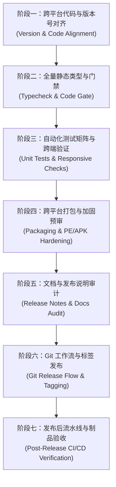

# WebRTC Gateway GUI 正式发版核对清单 (Official Release Checklist)

> **目标与规范说明**：  
> 本清单是 WebRTC Gateway Manager (GUI) 跨平台客户端每次发布新版本（正式版 / 次版本 / 补丁热修复版）的**强制工程门禁**。  
> 涵盖 **Windows 桌面端** 与 **Android 移动端**，所有发版流程必须严格按顺序执行并逐项确认，确保**零回归、零布局溢出、零孤儿进程泄漏、零破坏性变更**。

---

## 发版工作流全景图 (Release Workflow)



---

## 发版总则与版本语义规范 (Versioning Policy)

项目严格遵循 [Semantic Versioning 2.0.0 (SemVer)](https://semver.org/) 规范，版本号格式统一为 `vMAJOR.MINOR.PATCH`（例如 `v2.3.2`），并且**原则上与源项目 [WebRTC-Gateway](https://github.com/BeingNoAbility/WebRTC-Gateway) 内核主版本严格保持对齐**。

### 1. 版本号跃迁判定矩阵 (Version Increment Matrix)

| 版本类型 | 版本位 | 触发条件与变更范式 | 向后兼容性要求 | 门禁与验证要求 |
| :--- | :---: | :--- | :--- | :--- |
| **主版本 (Major)** | `vX+1.0.0` | UI 架构彻底重构、本地数据存储协议不兼容、通信与鉴权内核破坏性重写。 | 允许旧配置迁移或重置，但必须在 `docs/RELEASE_NOTES.md` 中给出明确的升级说明。 | **双平台全量真机实测**（Windows 10/11 + Android 7.0~15 各种主流异形屏/折叠屏全量跑满）。 |
| **次版本 (Minor)** | `vX.Y+1.0` | 新增核心功能模块（如新穿透模式、托盘快捷操作、新诊断工具箱）、UI 主题扩展。 | **严格向下兼容**既有配置文件、收藏夹与 YAML 规则；旧版本配置必须平滑无感升级。 | **针对性真机与异形屏抽样测试**（针对变更界面的宽窄屏与暗黑模式重点核验）。 |
| **补丁版本 (Patch)** | `vX.Y.Z+1` | 界面斑马线溢出修复、托盘图标生命周期自愈、进程守护健壮性修复、样式与文档微调。 | **严格 100% 向下兼容**；零数据模型与功能破坏。 | **本地自动化测试 (`flutter test`) + 静态代码检查 (`flutter analyze`)** 快速交付。 |

---

## 阶段一：跨平台代码与版本号对齐 (Version & Code Alignment)

- [ ] **1.1 Flutter 核心版本变量对齐**
  - **位置**：[pubspec.yaml](file:///pubspec.yaml) 中的 `version: X.Y.Z+1`
  - **操作**：对齐版本字符串为本次发版版本（如 `2.3.2+1`）。
  - **验证命令**：`flutter pub get`
  - **判定标准**：解析成功，依赖树锁定文件 `pubspec.lock` 正常刷新。

- [ ] **1.2 Windows PE 资源版本元数据对齐**
  - **位置**：[winres/winres.json](file:///winres/winres.json) 中的 `FileVersion` 与 `ProductVersion`
  - **操作**：将 Windows PE 文件版本更新为目标版本（如 `2.3.2.0`）。
  - **判定标准**：编译后的 exe 文件右键属性「详细信息」中正确显示产品名称与版本。

- [ ] **1.3 Windows 单文件引导器版本对齐**
  - **位置**：[tools/standalone_packer/main.go](file:///tools/standalone_packer/main.go)
  - **操作**：确认默认 fallback 版本与解压路径 `app_vX.Y.Z` 逻辑正常支持动态环境变量读取。

- [ ] **1.4 嵌入原生内核版本一致性断言**
  - **位置**：`assets/bin/agent.exe` 与 `assets/bin/signal.exe`
  - **核对项**：预置的 Go 二进制文件必须与当前目标发版内核版本严格对齐。
  - **验证命令**：
    ```powershell
    .\assets\bin\agent.exe -v
    .\assets\bin\signal.exe -v
    ```
  - **判定标准**：输出版本号必须与目标版本一致。

- [ ] **1.5 敏感信息与本地个人路径绝对零残留断言 (Zero Private Data)**
  - **核对项**：确保工程源码、配置、注释与历史中绝无本地绝对路径（如 `Users\Star`、`C:\flutter` 等）、真实私有 IP/域名或测试凭据。
  - **验证命令**：
    ```powershell
    Get-ChildItem -Path lib, test, tools, windows\runner, android\app\src -Recurse -File | Select-String "Users\\"
    ```
  - **判定标准**：输出必须为空。

---

## 阶段二：全量静态类型与门禁 (Typecheck & Linters)

- [ ] **2.1 Flutter 官方静态代码分析**
  - **验证命令**：
    ```bash
    flutter analyze --no-fatal-infos
    ```
  - **判定标准**：必须以退出码 `0` 完成，**零编译错误 (0 errors)、零致命警告 (0 warnings)**。

- [ ] **2.2 Dart 统一代码格式化**
  - **验证命令**：
    ```bash
    dart format --output=none --set-exit-if-changed lib test
    ```
  - **判定标准**：全量代码必须严格符合 Dart 官方排版规范，退出码为 `0`。

- [ ] **2.3 Android Gradle 与构建清单健全性**
  - **位置**：[android/gradlew](file:///android/gradlew)、[android/gradle/wrapper/gradle-wrapper.jar](file:///android/gradle/wrapper/gradle-wrapper.jar)
  - **核对项**：
    - 确认 `android/gradlew` 必须被 Git 纳入追踪且具备可执行权限（`100755`）；
    - 确认 `gradle-wrapper.jar` 绝不被 `.gitignore` 误杀，确保 Linux CI 环境能够正常引导 Gradle。

- [ ] **2.4 Windows CMake 与 Runner 配置健全性**
  - **位置**：`windows/CMakeLists.txt`、`windows/runner/resources/app_icon.ico`
  - **核对项**：C++ Runner 构建配置完备，官方图标资源有效存在。

---

## 阶段三：自动化测试矩阵与跨端验证 (Tests & Cross-Platform)

- [ ] **3.1 Flutter 全量自动化测试套件**
  - **验证命令**：
    ```bash
    flutter test
    ```
  - **判定标准**：覆盖 HMAC-SHA256 签名、时效链接解析、CLI 参数生成、Prometheus 指标解析与多实例生命周期等全部测试用例 **100% 通过 (10/10 Passed)**。

- [ ] **3.2 HMAC-SHA256 跨语言与跨平台签名一致性核验**
  - **核对项**：Dart 计算的带时效分享直连签名，必须与 Go 原生内核的 `crypto/hmac` 计算结果完全一致，绝不允许因编码或大小写差异导致访客打不开网页。

- [ ] **3.3 零溢出与全屏自适应布局核验 (Zero Pixel Overflow Invariant)**
  - **核对项**：
    - 在 360px ~ 480px 宽度手机视口下，各模块（穿透端、访客中心、信令端、诊断箱、日志台）绝不出现黄色斑马线溢出；
    - 在宽屏桌面（>= 800px）下，左侧 `NavigationRail` 与顶栏 HUD 流畅自适应展开；
    - 暗黑模式（Dark）与明亮模式（Light）对比度清晰，无文字隐形问题。

---

## 阶段四：跨平台打包与加固预审 (Packaging & Hardening)

- [ ] **4.1 Windows 独立单文件版 (Standalone .exe) 冒烟预审**
  - **打包命令**：
    ```powershell
    flutter build windows --release
    go run tools/standalone_packer/main.go
    ```
  - **核对项**：
    - 生成文件 `WebRTC-Gateway-Manager-Standalone.exe`；
    - 成功内嵌 Windows 清单（GUI 子系统，无黑框）；
    - 成功嵌入源项目官方 Cyber Shield 盾牌图标（多分辨率 ico）；
    - 成功应用 Authenticode 数字签名。

- [ ] **4.2 Windows 便携绿色版 (Portable Zip - 零误报) 校验**
  - **打包命令**：
    ```powershell
    Compress-Archive -Path "build\windows\x64\runner\Release\*" -DestinationPath "WebRTC-Gateway-Manager-vX.Y.Z-windows-x64-green.zip" -Force
    ```
  - **核对项**：压缩包解压后直接双击 `webrtc_gateway_gui.exe` 即刻正常拉起并托盘常驻，100% 杜绝杀软拦截。

- [ ] **4.3 Android 正式发布版 (Release APK) 优化与体积审计**
  - **打包命令**：
    ```bash
    flutter build apk --release
    ```
  - **核对项**：
    - 生成 `build/app/outputs/flutter-apk/app-release.apk`；
    - 开启 R8 代码混淆与图标 Tree-shaking，体积必须严格控制在 **80MB** 以内；
    - 具备正规发布签名，真机安装无报错。

- [ ] **4.4 孤儿进程防御与生命周期闭环审计**
  - **核对项**：在 Windows 任务管理器中测试：点击托盘「彻底退出程序」时，GUI 派生出的所有底层 `agent.exe` 与 `signal.exe` 子进程必须 100% 立即销毁退出，绝不允许留下孤儿进程继续监听端口。

---

## 阶段五：文档与发布说明审计 (Release Notes & Docs Audit)

- [ ] **5.1 docs/RELEASE_NOTES.md 单版本高信噪比规范**
  - **位置**：[docs/RELEASE_NOTES.md](file:///docs/RELEASE_NOTES.md)
  - **单版本不变量**：始终只维护**当前最新单一版本**，严禁累加历史版本。
  - **篇幅与结构红线**：
    - 控制在 **20 ~ 30 行** 极简高信噪比篇幅；
    - 包含：版本与日期、核心更新与修复、破坏性变更声明、下载制品说明与上游链接。

- [ ] **5.2 CHANGELOG.md 历史版本累积归档**
  - **位置**：[CHANGELOG.md](file:///CHANGELOG.md)
  - **核对项**：顶部追加新版本条目，按 `Added` / `Changed` / `Fixed` / `Security` 归档。

- [ ] **5.3 主文档与配置说明对齐**
  - **位置**：[README.md](file:///README.md)
  - **核对项**：徽章链接、最新版本号、托盘使用方法与多 Agent 集群说明与实际代码一致。

---

## 阶段六：Git 工作流与标签发布 (Git Release Flow & Tagging)

- [ ] **6.1 工作区整洁度绝对断言**
  - **验证命令**：
    ```bash
    git status --porcelain
    ```
  - **判定标准**：输出必须完全为空（`nothing to commit, working tree clean`）。

- [ ] **6.2 创建语义化 Git 附注标签 (Annotated Tag)**
  - **打标命令**：
    ```bash
    git tag -a vX.Y.Z -m "Release vX.Y.Z: <版本简要说明>"
    ```

- [ ] **6.3 推送主分支与标签触发 GitHub Actions**
  - **推送命令**：
    ```bash
    git push origin main --tags
    ```

---

## 阶段七：发布后流水线与制品验收 (Post-Release Verification)

- [ ] **7.1 自动发布流水线验收 (`auto_release.yml`)**
  - 打开 GitHub 仓库 Actions 页面，确认 `Auto Sync & Release GUI` 的 4 大 Job 全绿通过：
    1. `Check Upstream WebRTC-Gateway Release` (PASS)
    2. `Build Windows Desktop (Standalone & Green Zip)` (PASS)
    3. `Build Android APK` (PASS)
    4. `Publish GitHub Release` (PASS)

- [ ] **7.2 GitHub Releases 页面产物与哈希核验**
  - 确认 GitHub Releases 对应标签下挂载全部 4 个产物：
    - `WebRTC-Gateway-Manager-Standalone-vX.Y.Z.exe`
    - `WebRTC-Gateway-Manager-vX.Y.Z-windows-x64-green.zip`
    - `WebRTC-Gateway-Manager-vX.Y.Z-android.apk`
    - `SHA256SUMS.txt`

- [ ] **7.3 线上制品下载安装冒烟抽检**
  - 下载 Release 中的 Windows 单文件与 Android APK，在真实设备上双击打开/安装运行，确认托盘正常、各页面零溢出、Agent 启动成功。

---

## 应急回滚流程 (Emergency Rollback Playbook)

如果在发版后发现重大致命缺陷：
1. **撤回远程 Git Tag**：`git push origin :refs/tags/vX.Y.Z` 并删除本地标签；
2. **在 GitHub Releases 界面下架或删除有问题的 Release**；
3. **在主分支排查修复、补齐测试并重新打标发布**。
