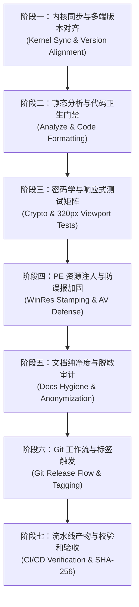

# WebRTC Gateway GUI 正式发版核对清单 (Official Release Checklist)

> **目标与工程定性**：  
> 本清单是 `WebRTC-Gateway-GUI` 跨平台客户端项目（Windows 桌面端 & Android 移动端）每次发布新版本（正式版 / 次版本 / 补丁热修复版）的**强制工程门禁**。  
> 本规范不罗列任何特定开发者的临时调试路径，而是立足于本项目的**全局根本架构与关键质量不变量**：包括上游 Go 原生内核同步、Windows 子进程生命周期守护、安卓移动端纯客户端响应式视口、HMAC-SHA256 纯数学时效鉴权对齐、单文件 PE 防杀软误报防线与 GitHub Actions 自动化发行。所有流程必须严格按顺序执行并逐项确认。

---

## 发版工作流全景图 (Release Workflow)



---

## 阶段一：内核同步与多端版本对齐 (Kernel Sync & Version Alignment)

- [ ] **1.1 上游 WebRTC-Gateway 原生内核版本一致性**
  - **根本追问**：GUI 内置打包的 `agent.exe` 与 `signal.exe` 是否与目标发版版本（如 `v2.3.2`）完全一致？
  - **核验路径**：`assets/bin/agent.exe` 与 `assets/bin/signal.exe`。
  - **验证命令**：
    ```powershell
    assets\bin\agent.exe -v
    assets\bin\signal.exe -v
    ```
  - **预期输出**：输出必须包含对应的上游语义化版本号，如 `WebRTC Gateway Agent v2.3.2` 与 `WebRTC Gateway Signal v2.3.2`。

- [ ] **1.2 Flutter 工程语义化版本对齐**
  - **位置**：[pubspec.yaml](file:///c:/Users/Star/Downloads/WebRTC-Gateway-GUI/pubspec.yaml) 中的 `version` 字段。
  - **操作**：将版本号订正为 `MAJOR.MINOR.PATCH+BUILD`（例如 `2.3.2+1`）。
  - **验证**：运行 `flutter pub get`，确保 `pubspec.lock` 处于最新状态且无版本冲突。

- [ ] **1.3 Windows PE 元数据与资源定义对齐**
  - **位置**：[winres/winres.json](file:///c:/Users/Star/Downloads/WebRTC-Gateway-GUI/winres/winres.json) 与 [tools/standalone_packer/main.go](file:///c:/Users/Star/Downloads/WebRTC-Gateway-GUI/tools/standalone_packer/main.go)。
  - **核验项**：
    - `winres.json` 中的 `file_version` 与 `product_version` 必须与发版版本一致（如 `2.3.2.0`）；
    - `standalone_packer` 中的启动器版本常量 `appVersion` 与 `go-winres` 参数必须同步对齐；
    - 应用程序图标 `windows/runner/resources/app_icon.ico` 必须与源项目 Logo 100% 保持一致。

---

## 阶段二：静态分析与代码卫生门禁 (Analyze & Code Formatting)

- [ ] **2.1 全量 Dart 规范代码格式化**
  - **操作**：对 `lib/` 生产源码与 `test/` 测试用例执行官方标准格式化：
    ```bash
    dart format --set-exit-if-changed lib test
    ```
  - **合格判定**：命令退出码为 `0`，没有任何未格式化或排版异常的文件。

- [ ] **2.2 静态代码零警告门禁**
  - **操作**：执行 Flutter 静态代码深度分析：
    ```bash
    flutter analyze --no-fatal-infos
    ```
  - **合格判定**：输出必须为 `No issues found!`，严禁遗留任何 `Error` 或致命 `Warning`。

---

## 阶段三：密码学与响应式测试矩阵 (Crypto & 320px Viewport Tests)

- [ ] **3.1 HMAC-SHA256 纯数学时效签名一致性验证**
  - **根本追问**：Dart 端生成的无状态安全访问链接是否能与上游 Go 服务端 100% 字节级握手成功？
  - **核对项**：
    - 签名载荷格式必须严格为 `nodeId:expiry_timestamp:accessSecret`；
    - 签名结果必须为标准 Hex 字符串；
    - 凭据参数必须附加在 URL Hash Fragment（`#nodeId?exp=...&sign=...`）之后，绝不允许放在 Query 参数中。
  - **验证命令**：`flutter test test/webrtc_gateway_test.dart`。

- [ ] **3.2 Prometheus HUD 监控指标文本流解析测试**
  - **核对项**：验证对上游 Agent `/metrics` 接口输出的标准 Prometheus 格式（接收/发送字节数、活跃连接数、数据流数）能正确解析并换算为实时速率。

- [ ] **3.3 移动端 320px 极窄视口零像素溢出断言 (Invariant 2.1)**
  - **根本追问**：在折叠屏外屏或极端窄屏设备（320px ~ 360px 宽度）下，界面是否彻底消灭黄色斑马线（`RenderFlex overflowed`）？
  - **验证命令**：`flutter test test/responsive_layout_test.dart`。
  - **合格判定**：测试通过，无任何 `FlutterError` 或像素溢出异常。

---

## 阶段四：PE 资源注入与防误报加固 (WinRes Stamping & AV Defense)

- [ ] **4.1 单文件启动器运行时释放路径规范**
  - **核心戒律**：单文件打包器解压路径**严禁设在 `%TEMP%` 目录下**！`%TEMP%` 是 Windows Defender 启发式木马扫描的高敏诱发区域。
  - **规范路径**：必须统一定位在 `%LOCALAPPDATA%\WebRTC-Gateway-Manager\app_<version>\`，遵从标准 Windows 应用安装与缓存规范。

- [ ] **4.2 双通道分发策略核验**
  - 检查 CI/CD 是否同时产出两套 Windows 制品：
    1. **单文件版 (`WebRTC-Gateway-Manager-Standalone-*.exe`)**：内嵌完整运行时，双击直开，免安装。
    2. **绿色便携版 (`WebRTC-Gateway-Manager-*-windows-x64-green.zip`)**：解压即用，零动态释放行为，作为严苛安全环境的 100% 防误报底线。

---

## 阶段五：文档纯净度与脱敏审计 (Docs Hygiene & Anonymization)

- [ ] **5.1 零私有信息与绝对路径脱敏红线**
  - **根本追问**：代码、示例配置、文档与提交历史中是否混入了任何开发者的私人用户目录（如绝对路径）、真实测试域名或私有 IP？
  - **排查命令**：
    ```bash
    git grep -i "Users\\\\"
    git grep -i "192.168."
    ```
  - **合格判定**：除标准测试占位符（`127.0.0.1`、`example.com`）外，检索结果必须全空。

- [ ] **5.2 发布说明 (Release Notes) 纯净度**
  - **位置**：[docs/RELEASE_NOTES.md](file:///c:/Users/Star/Downloads/WebRTC-Gateway-GUI/docs/RELEASE_NOTES.md)。
  - **规范要求**：作为 GitHub Release 的发布正文，**仅且只能包含当前最新版本的核心更新说明**，严禁在文档中残留历史版本混杂（所有历史变更统一沉淀在 [CHANGELOG.md](file:///c:/Users/Star/Downloads/WebRTC-Gateway-GUI/CHANGELOG.md)）。

---

## 阶段六：Git 工作流与标签触发 (Git Release Flow & Tagging)

- [ ] **6.1 Git 工作区 Cleanliness 验证**
  - 运行 `git status`，确保所有生产改动、文档与测例均已暂存并提交，工作区干净无未跟踪垃圾文件。

- [ ] **6.2 创建标准附注语义化标签**
  - 创建符合 SemVer 的 Git 附注标签并推送到远端：
    ```bash
    git tag -a v2.3.2 -m "Release v2.3.2: Modern Cross-Platform GUI for WebRTC-Gateway"
    git push origin v2.3.2
    ```

---

## 阶段七：发布后流水线与制品验收 (Post-Release CI/CD Verification)

- [ ] **7.1 GitHub Actions 全端自动化构建验收**
  - 访问 GitHub Actions 控制台，验证工作流 `Auto Sync & Release GUI` 的所有任务成功完成：
    - `Check Upstream WebRTC-Gateway Release` (绿灯通过)
    - `Build Windows Desktop (Standalone & Green Zip)` (绿灯通过)
    - `Build Android APK` (绿灯通过)
    - `Publish GitHub Release` (绿灯通过)

- [ ] **7.2 资产完整性与 SHA-256 校验**
  - 打开对应的 GitHub Release 页面，确认以下发布资产齐全可用：
    1. `WebRTC-Gateway-Manager-Standalone-vX.Y.Z.exe`
    2. `WebRTC-Gateway-Manager-vX.Y.Z-windows-x64-green.zip`
    3. `WebRTC-Gateway-Manager-vX.Y.Z-android.apk`
    4. `SHA256SUMS.txt`
  - 下载验证 SHA-256 哈希值与本地构建产物一致无误。
