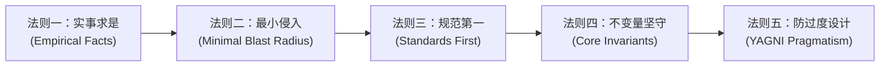
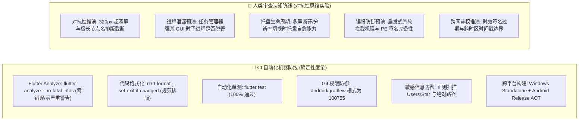
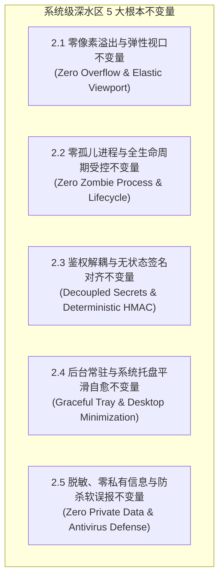

# WebRTC Gateway GUI 辩证审查原则与核对清单 (Dialectical Review Guidelines & Checklist)

> **导言与定性**：  
> 在跨平台 GUI、系统托盘常驻、子进程生命周期守护与 WebRTC 穿透客户端工程中，“审查”（Code Review & Architecture Review）不仅是一道代码质量门禁，更是**对交互路线、平台规范与工程哲学的辩证思辨**。  
> 本指南旨在跳出“UI 只要自己电脑看起来正常就行”的本位傲慢，清晰界定**“自动化 CI 机器防线”**与**“人类对抗性推演防线”**的权责边界，建立一套**直击跨端底层不变量、拒绝盲从、实事求是、控制爆炸半径**的辩证审查标准与操作清单。

---

## 一、 辩证审查的核心心法 (Dialectical Mindset)

### 1. 反对两种认知偏见

1. **盲从与教条主义 (Blind Compliance)**：
   - *表现*：盲目引入笨重或已弃用的第三方 Flutter 依赖，遇到布局错误就粗暴嵌套 `SingleChildScrollView` 或加全局滚动，导致手势冲突与性能退化。
   - *戒律*：任何外部包引入**必须经过第一性原理推演**。必须反问：该插件是否支持 Windows 和 Android 双平台？是否会导致 CI 环境缺少依赖？能否用 Flutter 原生组件（如 `LayoutBuilder`、`Wrap`）更优雅地闭环？
2. **本位傲慢与经验主义 (Defensive Arrogance)**：
   - *表现*：开发者在宽屏桌面或大尺寸手机模拟器上调试，看到界面排版正常，就认为“测试全绿无 Bug”，对窄屏溢出（Yellow/Black Overflow 条纹）不以为意。
   - *戒律*：个人开发环境的屏幕分辨率**无法代表真实世界的多样性**。必须敬畏生产环境中千奇百怪的设备（如折叠屏外屏 320px、高缩放 DPI 桌面、系统暗黑模式切换、突发性进程挂死）。

### 2. 辩证审查的五大黄金法则 (The 5 Golden Principles)

| 原则 | 核心内涵 | 辩证执行准则 |
| :--- | :--- | :--- |
| **一、实事求是与工程归因** | 拒绝模糊定性，一切以证据、异常日志与视觉事实说话。 | 区分“响应式布局边界缺陷”、“进程生命周期泄漏”与“底层网络超时”。归因必须精确到具体 widget 或系统事件。 |
| **二、最小侵入与受控爆炸半径** | 凡能用 5 行代码封堵的边界，坚决不用 50 行重构。 | 优先考虑局部自适应折叠与弹性旁路，严禁在修复一个界面的同时随手重构整个页面的状态流。 |
| **三、规范第一与平台原生准则** | 遇到行为争议，向平台官方设计规范看齐。 | Windows 遵从 Desktop 窗口与托盘规范（关闭到托盘、无黑框 GUI），Android 遵从 Material 3 与触控规范。 |
| **四、不变量坚守 (Invariants)** | 任何修改不得动摇跨平台 GUI 的根基设计。 | 坚守“零像素溢出”、“零孤儿进程泄漏”、“纯数学时效签名一致性”三大核心不变量。 |
| **五、反过度设计 (YAGNI)** | 适度超前，但绝不提前透支复杂度。 | 拒绝在没有实际业务需要的情况下引入复杂外部数据库、过度分层的状态总线或脆弱的外部打包脚本。 |

### 3. 权责解耦：机器防线 vs 人类认知防线

---

## 二、 GUI 五大系统级深水区根本不变量审查 (The 5 Systemic GUI Invariants)

### 维度一：界面渲染与跨端响应式审查

- [ ] **2.1 零像素溢出与弹性视口不变量 (Zero Pixel Overflow Invariant)**
  - **根本追问**：页面在各种极窄屏、大字号无障碍设置或高 DPI 下是否绝不出现黄色斑马线（`RenderFlex overflowed`）？
  - **辩证推演**：
    - 是否在横向 `Row` 内直接放置未被 `Expanded` 或 `Flexible` 约束的输入框、长文本或大按钮？
    - 当屏幕宽度从 1920px 骤降到 360px（普通手机）甚至 320px（折叠屏外屏）时，内容是否能优雅折行（`Wrap`）或垂直堆叠（`LayoutBuilder`）？
    - 文本超长时是否配置了 `overflow: TextOverflow.ellipsis`，标题是否具备自动截断弹性？
  - **合格判定**：在 320px ~ 4K 全尺寸视口下，任何操作与文本输入均无黄色溢出条纹。

### 维度二：进程管理与生命周期受控审查

- [ ] **2.2 零孤儿进程与全生命周期受控不变量 (Zero Zombie Process Invariant)**
  - **根本追问**：GUI 作为宿主启动底层的 Go 核心时，子进程的生命周期是否被 100% 闭环掌控？
  - **辩证推演**：
    - 当用户点击托盘「彻底退出程序」、直接关闭应用或系统注销时，已启动的 `agent.exe` 与 `signal.exe` 是否会变成孤儿进程遗留在后台继续占用端口？
    - `ProcessRunner` 是否在应用销毁时执行了显式的 `kill()` 信号派发与资源回收？
    - 重复点击“启动”时，是否有并发锁防抖机制，杜绝同时拉起两个同配置的实例导致端口争抢？
  - **合格判定**：应用退出后，系统进程管理器中绝无残留的 WebRTC 进程。

### 维度三：安全鉴权与算法对齐审查

- [ ] **2.3 鉴权解耦与无状态签名对齐不变量 (Decoupled Secrets & Deterministic HMAC)**
  - **根本追问**：客户端计算的直连分享签名是否与服务端算法完全严丝合缝？
  - **辩证推演**：
    - Dart 实现的 `HmacSigner` 是否使用了标准 HMAC-SHA256 算法？与 Go 内核的计算结果是否 100% 逐字节对齐？
    - 控制面凭据（`SIGNAL_SECRET`）是否绝不对普通访客暴露？生成的分享链接是否只携带带有过期时效（`exp`）的数学签名（`sign`）？
  - **合格判定**：所有带时效的直连链接均可被官方 Go 信令端成功撮合并通过校验。

### 维度四：桌面端托盘常驻与系统集成审查

- [ ] **2.4 后台常驻与系统托盘平滑自愈不变量 (Graceful Tray & Desktop Minimization)**
  - **根本追问**：Windows 端关闭主窗口时，托盘接管是否平滑且不破坏正在进行的穿透任务？
  - **辩证推演**：
    - 用户关闭主窗口时是否无感隐藏至任务栏小图标，且所有运行中的 Agent 数据通道不中断？
    - 托盘右键菜单是否具备完整的应急操作能力（显示、批量启停、彻底退出）？
    - 左键单击/双击是否能可靠唤醒并置顶窗口，避免窗口隐藏后“无法呼出”成为死进程？
  - **合格判定**：托盘生命周期与窗口状态机一致，用户可在设置中自由切换开启/关闭。

### 维度五：隐私脱敏与杀毒软件防御审查

- [ ] **2.5 脱敏、零私有信息与防杀软误报不变量 (Zero Private Data & Antivirus Defense)**
  - **根本追问**：提交入库的代码中是否绝无本地隐私，生成的二进制文件是否具备防误报设计？
  - **辩证推演**：
    - 源码与配置中是否有本地绝对路径（`C:\Users\...`）、开发者私人邮箱或真实生产 IP？
    - 单文件可执行文件（`.exe`）是否注入了正规的 Windows GUI 清单与产品元数据，杜绝无清单程序触发高危启发式报毒？
    - 是否提供了不依赖临时目录释放的绿色免安装包（Zip）双轨发版机制？
  - **合格判定**：敏感词扫描为零，PE 资源完备，数字签名有效。

---

## 三、 辩证审查经典案例库 (GUI Post-Mortem Case Studies)

本章节沉淀在 WebRTC-Gateway-GUI 演进过程中攻坚克难的经典案例，作为后续迭代的指导范式：

### 案例 1：Android 4 处屏幕黄黑斑马线溢出之辩 ——【固宽 Row 强行并排 vs LayoutBuilder 双层流式排版】
- **现象**：在手机竖屏（360px）上，控制台日志页溢出 37px，信令服务卡片溢出 183px，访客中心溢出 229px，Agent 卡片溢出 89px。
- **浅层做法**：在最外层套一个水平横向滚动条（`SingleChildScrollView(scrollDirection: Axis.horizontal)`）。
- **深水区陷阱**：横向滚动条会与用户在触控屏上的上下滑动与右滑返回手势剧烈冲突，卡片被截断体验极差，治标不治本。
- **辩证解法**：采用 `LayoutBuilder` 判断视口宽度（如 `< 600px`），自适应降级为“上层信息元数据，下层通栏主操作按钮”的双层流式排版；将固宽分段器改为自适应 Dropdown，彻底消除全部 4 处溢出。

### 案例 2：Windows 单文件免安装器黑屏秒退之辩 ——【HideWindow 误杀 vs GUI 子系统正常派发】
- **现象**：Go 打包器封装的独立 exe 双击打开毫无反应，任务管理器闪烁后直接消失。
- **深水区陷阱**：打包引导器误将调起主程序的 Windows 启动标志设置为了 `HideWindow: true`，导致 Flutter 窗口初始化完成后被操作系统强行隐藏；且使用了阻塞等待导致进程被卡死。
- **辩证解法**：移除 `HideWindow` 强制隐藏指令，改用正常的非阻塞 GUI 进程派发；引导器自解压后启动子进程并秒退，零内存常驻；同时注入 Windows 原生 `MessageBoxW` 弹窗拦截解压与启动异常。

### 案例 3：可执行文件源项目图标丢失之辩 ——【go-winres simply 遗漏 vs go-winres patch PE 资源硬注入】
- **现象**：Go 编译单个 `launcher.go` 时，目录下的 `.syso` 资源文件被 Go 编译器自动忽略，生成的 exe 依然是 Windows 默认白色空白图标。
- **深水区陷阱**：Go 工具链在编译单文件参数（`go build launcher.go`）时，不会自动链接目录内的 `.syso` 资源。
- **辩证解法**：在编译产物生成后，显式调用 `go-winres patch --in winres/winres.json --no-backup`，对 exe 二进制的 PE 资源表直接执行硬写入，确保官方 Cyber Shield 图标与清单 100% 固化在文件内部。

### 案例 4：Windows 资源管理器图标不更新之辩 ——【程序重打包无用 vs IconCache.db 强缓存原理与无感刷新】
- **现象**：exe 内部已确认成功注入了官方盾牌图标，但用户电脑上双击覆盖下载后依然显示旧图标。
- **认知偏见**：误以为打包工具仍有问题，陷入反复无效重编。
- **辩证解法**：揭示 Windows 资源管理器 `IconCache.db` 强缓存原理：同路径同名文件会被 Explorer 缓存旧图标。只需将文件改名、移动到新目录，或者运行 `ie4uinit.exe -show` 即可即时加载官方 Logo。

### 案例 5：杀毒软件启发式报毒拦截之辩 ——【单文件自释放器被杀 vs Authenticode 本地签名与便携绿色包双轨制】
- **现象**：单文件版在某些高敏杀软（开启启发式全盘监控）环境下，因将自身解压到 `%LOCALAPPDATA%` 而被判定为“疑似 Dropper 释放木马”。
- **辩证解法**：
  1. 实行发版双轨制：除单文件版外，同步发布全 DLL 依赖预打包的绿色便携解压包（Zip），零动态释放行为，天生杜绝误报；
  2. 为单文件版注入 Authenticode 数字签名，并配套本地一键信任 PowerShell 脚本，彻底解决企业与严苛环境下的拦截痛点。

### 案例 6：GitHub Actions Gradle 脚本缺失阻断之辩 ——【.gitignore 误杀 wrapper vs 100755 权限制式入库】
- **现象**：GitHub Actions 初次构建 Android 时在 `flutter build apk` 步骤以退出码 1 失败。
- **深水区陷阱**：`android/.gitignore` 粗暴地将 `gradlew`、`gradlew.bat` 与 `gradle-wrapper.jar` 忽略，导致推送到远端仓库后缺失 Gradle 引导程序。
- **辩证解法**：修正 `.gitignore`，将 Wrapper 全套制式脚本纳管入库，并在 Git 索引中赋予 `android/gradlew` `100755` 可执行权限，CI 运行畅通无阻。

---

## 四、 审查结果定性与签核规范 (Sign-off Matrix)

| 审查裁定等级 | 适用情境 | 下一步动作 |
| :---: | :--- | :--- |
| 🟢 **ACCEPT (无保留通过)** | 方案符合五大黄金原则，各平台零溢出、零进程泄漏，测试全部通过，无隐私数据残留。 | 可直接合并入 `main` 分支。 |
| 🟡 **DEFENSIVE PATCH (需防御性微调)** | 核心逻辑成立，但在 320px 极端窄屏或特定 DPI 下有轻微截断风险（< 20 行自适应代码可修正）。 | 提出最小侵入性修复建议，补齐自适应微调后通过。 |
| 🔴 **REJECT (原则性否决)** | 方案破坏核心不变量（如导致斑马线溢出、遗留孤儿进程、泄露绝对路径或敏感凭据）。 | 指出违背的不变量条款与推演事实，退回重做。 |
