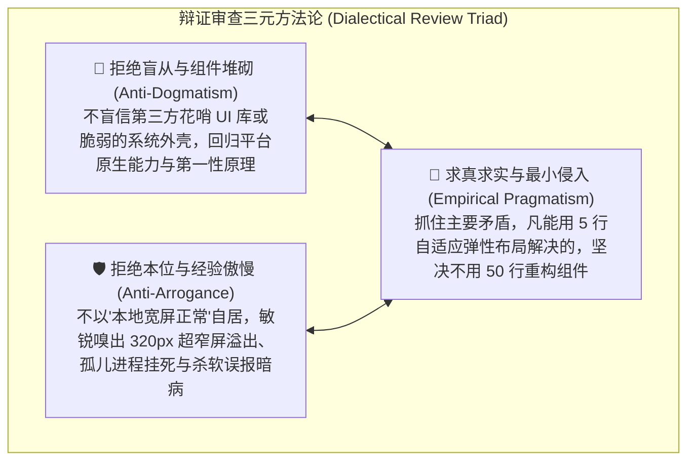
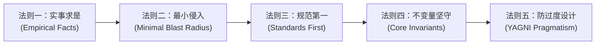
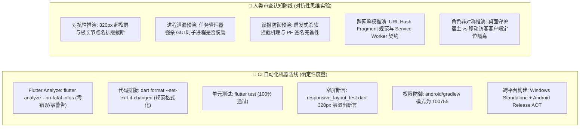
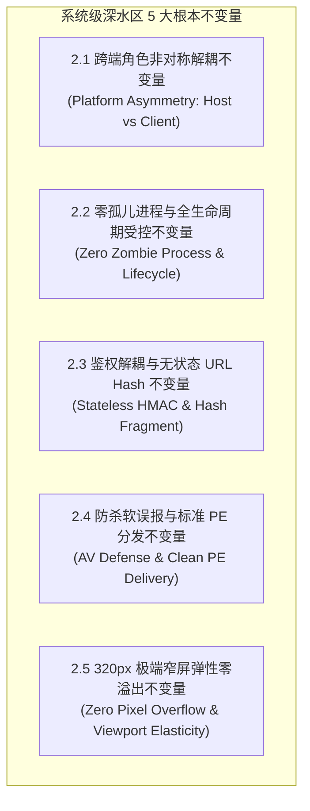

# WebRTC Gateway GUI 辩证审查原则与核对清单 (Dialectical Review Guidelines & Checklist)

> **导言与定性**：  
> 在跨平台图形界面、Windows 系统托盘常驻守护、Go 原生子进程生命周期管理与 WebRTC 穿透客户端工程中，“审查”（Code Review & Architecture Review）不仅是一道代码质量门禁，更是**对技术路线的辩证思辨与工程哲学把关**。  
> 本指南跳出“UI 只要在开发者电脑看起来正常就行”的本位傲慢，清晰界定**“自动化 CI 机器防线”**与**“人类对抗性推演防线”**的权责边界，建立一套**直击跨端底层不变量、拒绝盲从、实事求是、控制爆炸半径**的辩证审查标准与实战案例库。

---

## 一、 辩证审查的核心心法 (Dialectical Mindset)

### 1. 反对两种认知偏见

1. **盲从与教条主义 (Blind Compliance)**：
   - *表现*：盲目引入笨重或跨端兼容性差的第三方依赖；遇到布局错误粗暴包裹全局 `SingleChildScrollView`，导致手势冲突、列表渲染失效与性能急剧恶化。
   - *戒律*：任何外部依赖引入**必须经过第一性原理推演**。必须反问：该插件是否同时原生支持 Windows 与 Android？是否会增加 CI 构建断裂风险？能否用 Flutter 原生组件（如 `LayoutBuilder`、`Wrap`、`Expanded`）以最小代码量闭环？
2. **本位傲慢与经验主义 (Defensive Arrogance)**：
   - *表现*：开发者在桌面 1080p 宽屏或大屏模拟器上调试，看到界面排版正常，就认为“测试全绿无 Bug”，对极端窄屏或暗黑模式下的布局溢出不以为意。
   - *戒律*：个人开发环境无法代表真实世界的设备多样性。必须敬畏真实生产环境中的极端边界（如折叠屏外屏 320px、高 DPI 缩放、系统托盘多屏断开重连、突发性进程异常挂死）。

### 2. 辩证审查的五大黄金法则 (The 5 Golden Principles)

| 原则 | 核心内涵 | 辩证执行准则 |
| :--- | :--- | :--- |
| **一、实事求是与工程归因** | 拒绝模糊定性，一切以证据、异常日志与视觉事实说话。 | 准确界定“响应式视口边界缺陷”、“子进程生命周期泄漏”与“底层网络超时”。归因必须精确到具体 widget、系统信号或 IPC 通道。 |
| **二、最小侵入与受控爆炸半径** | 凡能用 5 行代码封堵的边界，坚决不用 50 行重构。 | 优先考虑局部自适应折叠与弹性降级，严禁在修复局部排版问题的同时随手重构全局状态管理。 |
| **三、规范第一与平台原生准则** | 遇到行为争议，向平台官方设计规范看齐。 | Windows 端遵从 Desktop 窗口与托盘规范（关闭到托盘、无黑框后台常驻、标准 LocalAppData 存储）；Android 端遵从触控与 Material 3 自适应规范。 |
| **四、不变量坚守 (Invariants)** | 任何修改不得动摇跨平台 GUI 的根基设计。 | 坚守“移动端零像素溢出”、“桌面端零孤儿进程泄漏”、“纯数学 HMAC 时效签名绝对一致”三大系统级不变量。 |
| **五、反过度设计 (YAGNI)** | 适度超前，但绝不提前透支复杂度。 | 拒绝在没有实际业务需要的情况下引入复杂外部数据库、过度分层的抽象总线或不可靠的外挂脚本。 |

### 3. 权责解耦：机器防线 vs 人类认知防线

---

## 二、 GUI 五大系统级深水区根本不变量审查 (The 5 Systemic GUI Invariants)

### 2.1 跨端角色非对称解耦不变量 (Platform Asymmetry: Host vs Client)
- **根本追问**：不同操作系统形态各异，GUI 是否对不同平台做出了符合操作系统规律的角色划分？
- **辩证推演**：
  - Windows 桌面端拥有完整的本地文件系统与进程派生权限，其核心角色是**守护宿主（Daemon Host & Supervisor）**：负责并发启动与监控 `agent.exe` 与 `signal.exe`、收集标准输出、监控端口占用并常驻系统托盘；
  - Android 移动端运行在沙箱中，缺乏任意派生可执行文件的原生环境，其核心角色是**访客远程直连与移动控制中心 (Visitor & Connection Hub)**：负责解析分享链接、管理常用节点书签、网络健康检查与通过系统浏览器直达 WebRTC Service Worker 门户。
- **合格判定**：严禁在 Android 端强行模拟桌面子进程行为；所有桌面特有模块（`ProcessRunner`、`TrayService`、`window_manager`）在移动端均能优雅旁路，不发生抛错。

### 2.2 零孤儿进程与全生命周期受控不变量 (Zero Zombie Process Invariant)
- **根本追问**：GUI 作为宿主启动底层的 Go 核心时，子进程的生命周期是否被 100% 闭环掌控？
- **辩证推演**：
  - 当用户点击关闭窗口、系统关机或 GUI 发生未捕获异常退出时，后台运行的 `agent.exe` 和 `signal.exe` 是否会脱管变成孤儿进程？
  - 如果残留孤儿进程，下一次启动时端口（如 `:8888` 或反代端口）被旧进程占死，导致新实例静默报错；
  - 启动前是否具备端口连通性嗅探与预检能力？窗口关闭事件是否被拦截并优先转入托盘后台？
- **合格判定**：GUI 退出时必须通过系统信号或进程树级联终止子进程；启动前必须对目标监听端口进行探针检测，发现冲突立即提示或清理，严禁端口被幽灵进程霸占。

### 2.3 鉴权解耦与无状态 URL Hash 不变量 (Stateless HMAC & Hash Fragment Invariant)
- **根本追问**：生成的安全访问直连链接是否能被 WebRTC 网关完全识别？凭据传输是否安全？
- **辩证推演**：
  - 密钥参数与 Node ID **必须位于 URL Hash Fragment（`#` 之后）**（如 `http://portal:8888/#myhome?exp=...&sign=...`），绝对不能以标准 Query 参数（`?` 之前）出现；
  - *原因*：URL Fragment 不会随 HTTP 请求行发送至服务器或 CDN，从而避免访客凭据在传输层日志中泄露；上游网关由前端 Service Worker 专门拦截并解析 Hash 内容；
  - Dart 端 `HmacSigner` 的计算逻辑（`nodeId:expiry_timestamp:accessSecret`）必须与 Go `crypto/hmac` 保持 100% 字节级一致。
- **合格判定**：无论直接拼接还是由剪贴板解析，链接中的关键参数绝不遗失，HMAC 签名通过测试矩阵双向交叉验证。

### 2.4 防杀软误报与标准 PE 分发不变量 (AV Defense & Clean PE Delivery)
- **根本追问**：Windows 分发文件是否会被 Windows Defender 或第三方安全软件误判为木马拦截？
- **辩证推演**：
  - 传统打包工具常将运行时动态释放到 `%TEMP%` 目录下执行，这是启发式杀毒引擎（如 Trojan:Win32/Wacatac）的首要特征；
  - 正规单文件启动器必须释放到标准应用支持目录（`%LOCALAPPDATA%\WebRTC-Gateway-Manager\app_<version>\`）；
  - 编译可执行文件时必须使用 `go-winres` 正规嵌入应用程序图标、清单（Manifest）与产品版本元数据（`2.3.2.0`），坚决杜绝“无头裸体 PE”；
  - 必须同时提供**零释放行为的绿色便携压缩包（Green Zip）**，作为企业级苛刻环境的绝对安全兜底。
- **合格判定**：双通道分发包均可流畅执行，且元数据完整。

### 2.5 320px 极端窄屏弹性零溢出不变量 (Zero Pixel Overflow & Viewport Elasticity)
- **根本追问**：页面在各种极窄手机屏（320px ~ 360px）或高系统字号缩放比例下，是否绝不出现黄色斑马线（`RenderFlex overflowed`）？
- **辩证推演**：
  - 横向 `Row` 内严禁直接平铺多个未加约束的按钮或长文本；
  - 每一个包含按钮与文本的复合卡片，必须使用 `LayoutBuilder` 针对断点（如 560px / 600px）进行局部响应式自适应，在宽屏下横向排列、在窄屏下垂直折叠；
  - 文本标题必须配置 `maxLines: 1` 与 `overflow: TextOverflow.ellipsis`；工具栏图标必须启用 `VisualDensity.compact`。
- **合格判定**：在 320px 物理测试视口下，运行 `responsive_layout_test.dart` 测试全部通过，无任何界面溢出。

---

## 三、 辩证审查经典案例库 (Post-Mortem Case Studies)

### 案例 1：幽灵端口霸占之辩 ——【子进程脱管与静默绑定失败】
- **现象**：用户在任务管理器中关闭 GUI 后再次打开，发现穿透服务启动失败，日志提示 `listen tcp :8888: bind: address already in use`。
- **根因分析**：直接通过任务管理器结束 Flutter 宿主进程时，Go 子进程由于没有建立 Windows Job Object（作业对象）关联，变成了无父进程的孤儿进程，继续持有端口监听。
- **治本之策**：
  1. 引入进程管理生命周期守护，启动前先通过 Socket 探测端口是否可用；
  2. 桌面端集成系统托盘常驻，拦截常规窗口关闭事件，在托盘菜单提供“彻底退出并终止所有核心”的一键清理机制。

### 案例 2：URL Hash Fragment 之辩 ——【为什么凭据不能写在 Query 里】
- **现象**：早期尝试将分享链接生成为 `http://portal:8888/?node=myhome&exp=...`，结果访问时控制台报 404，穿透通道无法建立。
- **根因分析**：上游 WebRTC Gateway 的设计哲学是“零客户端”，它依靠注册在浏览器端的 Service Worker 拦截页面请求。而 Service Worker 依赖 URL 中的 Hash Fragment（`#`）提取目标 Node ID 与加密凭据。如果写在 `?` Query 中，HTTP 请求会直接打向信令服务后端而无法被前端虚拟网关拦截。
- **治本之策**：固化 URL Hash 规范不变量，所有直连链接统一输出为 `http://host:port/#nodeId?exp=...&sign=...`。

### 案例 3：防杀软误报之辩 ——【%TEMP% 释放的惨痛教训】
- **现象**：单文件版 `.exe` 在部分 Windows 机器下载后被 Windows Defender 拦截报毒并直接隔离。
- **根因分析**：早期打包脚本简单将二进制释放至 `%TEMP%\...`，且生成的 exe 缺少标准 Windows PE 资源段（无图标、无版本号、无清单）。Windows Defender 启发式规则对“临时目录自解压并执行子进程的无签名程序”极度敏感。
- **治本之策**：
  1. 释放目录重构为标准 `%LOCALAPPDATA%\WebRTC-Gateway-Manager\app_<version>\`；
  2. 编译链路全面接入 `go-winres`，自动嵌入正规图标、Win32 Manifest 清单与四位版本号；
  3. 提供纯净绿色 Zip 包作为企业机房与高安全环境的备用交付形态。

### 案例 4：移动端 320px 黄色斑马线之辩 ——【全局滚动 vs 局部自适应】
- **现象**：在窄屏手机上打开日志、服务端管理和节点卡片时，频繁爆出 `RIGHT OVERFLOWED BY 183 PIXELS` 的黄色溢出条纹。
- **根因分析**：在桌面宽屏思维下，开发者习惯在 `Row` 中并排放置信息卡片与大尺寸操作按钮。在移动端屏幕宽度不足 360px 时，未设置弹性约束的组件直接挤出屏幕右侧。
- **治本之策**：
  1. 坚决不使用粗暴的全局包裹 `SingleChildScrollView`（破坏页面布局稳定与上下手势）；
  2. 针对各卡片通过 `LayoutBuilder` 设定局部断点（< 560px / < 600px），窄屏时操作按钮自动优雅流式沉降到卡片底部；
  3. 编写 `responsive_layout_test.dart` 自动化测试，将 320px 视口无溢出写入流水线机器门禁。

### 案例 5：CI 流水线公共 IP 速率限制之辩 ——【curl 裸调 vs 官方 gh CLI】
- **现象**：GitHub Actions 自动化流水线在第 1 步拉取上游发布信息时频繁报错退出：`Could not retrieve release information`。
- **根因分析**：在 Ubuntu 公共运行器上直接使用 `curl -s` 访问 GitHub REST API 未携带认证凭据。由于 Azure 公共 IP 池被全球大量流水线共享，极易触发 GitHub 对未认证请求的 60 次/小时速率限制（HTTP 403 Rate Limit Exceeded），导致返回 JSON 异常引发脚本断裂。
- **治本之策**：
  1. 全面淘汰裸 `curl`，切换为内置认证的 `gh api`（具备 5,000 次/小时配额保障）；
  2. 在标签推送事件（`push: tags`）发生时，直接解构 `${{ github.ref_name }}` 作为确定性发版目标，解耦对外部接口的脆弱依赖。
